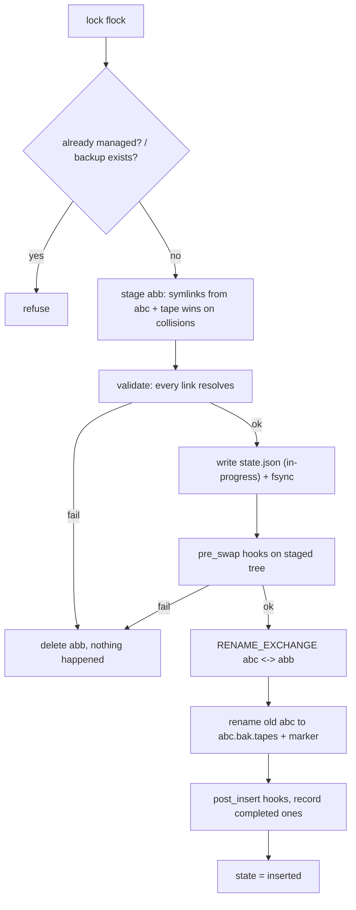
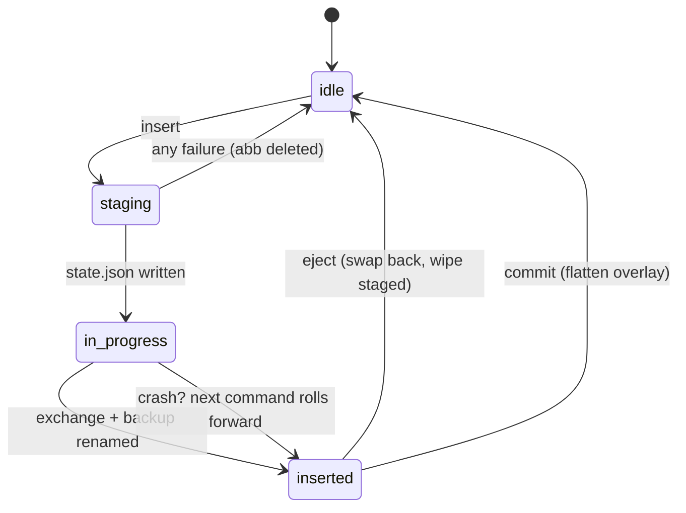

# THIS FILE IS AI GENERATED BECAUSE I HAD AI SUGGEST CAVEATS AND WHAT TO DO IN ORDER TO ENSURE ATOMICITY AND SAFETY 
# TAPES IS HAND-WRITTED AND AT THE BARE LEAST WITHOUT CONSIDERING THIS FILE, AI WAS USED NO LESS THAN YOU WOULD USE STACK OVERFLOW BACK IN THE DAY
# tapes


an atomic, per-target dotfile switcher and manager. you "insert" a tape (a git repo of config overrides) into a target (like `~/.config`), your config *becomes* the tape's version without touching your real files, and you "eject" to go back like nothing happened. `commit` if you decide to keep it.

the core trick: **build the entire new view off to the side, then flip one pointer atomically.** no half-states, no guessing on teardown, instant rollback. same idea nix profile switching uses, but at the config-folder level with symlinks + rename.

## vocabulary

- **tape** — a git repo containing config you want to layer on (a "cassette" of config)
- **target** — the dir being managed, e.g. `~/.config` (a "deck")
- **abc** — shorthand in this doc for the target dir
- **acc** — shorthand for the tape's own config folder
- **abb** — the staging dir tapes builds (sibling of `abc`, same filesystem — this is an invariant, `RENAME_EXCHANGE` requires it)
- **abc.bak.tapes** — the backup of your original dir, made during insert
- **records.json / state.json** — the state file insert writes so eject never guesses

## tape.toml

```toml
name = "my-theme"
repo = "https://github.com/you/my-theme"   # filled by install, commit-pinned

# target overrides. tapes only symlinks the folders listed here,
# and a target can be remapped so e.g. chromium themes land where
# they belong without stomping anything else.
[target."~/.config"]
"chromium" = "chromium"          # tape path -> target-relative path
"themes/rofi" = "rofi"

[hooks]
pre_swap = []      # run against the STAGED tree, before the swap
post_insert = []   # run after the swap; recorded, eject runs on_eject in reverse
on_eject = []      # compensating hooks, run in reverse order on eject
```

## the four commands

### `tapes install <repo>`

the boring one. `git clone` the repo, generate the `tape.toml` (pinned to the exact commit so updates are explicit), validate its target hashmap before trusting it, refuse on name collision with an existing tape.

### `tapes insert <tape>`

the hard one. step by step, using `~/.config` as `abc`:

1. **lock.** take an `flock` on `.tapes.lock`. if another tapes is running, refuse.
2. **refuse if managed already** (no stacking, no nested inserts for now). refuse if `abc.bak.tapes` exists. check the marker `.tape-managed` isn't already in `abc`.
3. **stage.** create `abb` as a sibling of `abc` (same fs, non-negotiable):
   - symlink every entry in `abc` that the tape *doesn't* touch → points at `abc/...` (these stay valid after the swap, since the *path* `abc` is then the staged dir — self-referential but correct)
   - symlink the tape's entries from `acc` into `abb` (these don't come from `abc` — the tape wins at any path collision)
   - if the tape overrides only *one file* inside an otherwise-untouched folder, symlink that file directly and the rest of the folder comes from `abc` (folder stays, single-file override)
   - **absolute symlinks only.** relative ones break on the rename
4. **validate.** walk the staged dir, verify every symlink target resolves. no dangling links get swapped in, ever. any failure here = just delete `abb`, nothing happened.
5. **journal.** write state.json *before* the swap, fsync it: which tape, which target, og path → symlink path for every link, which hooks ran, paths of `abb`/`abc.bak.tapes`, status = `in-progress`.
6. **run `pre_swap` hooks against the staged tree.** they see the future config, and they're disposable — if they fail, delete `abb`, done. nothing was touched.
7. **swap.** `renameat2(abc, abb, RENAME_EXCHANGE)` — one syscall, `abc` and `abb` trade names atomically. there is no window where `abc` doesn't exist. the old `abc` (your real config) now sits at the `abb` path — `rename()` it to `abc.bak.tapes` and drop a `.tapes.lock` marker inside it (eject will not touch a backup without its marker).
   - `RENAME_EXCHANGE` needs kernel 3.15+ and fs support (ext4/btrfs/xfs/tmpfs fine; overlayfs/network fs → `EINVAL`/`ENOSYS`). probe at startup; fall back to the journaled two-rename dance (`abc`→`abc.bak.tapes` then `abb`→`abc`, crash-safe because the journal says `in-progress`).
   - no libc wrapper — `syscall(SYS_renameat2, ...)`
8. **run `post_insert` hooks**, record *which ones completed* in state.json.
9. **commit the journal**: status = `inserted`. done.

**atomicity rule for the whole tool: journal → act → commit.** any command that finds status `in-progress` offers to roll forward or back.

### `tapes eject`

the easy one, because insert did all the work:

1. `flock` the lock.
2. read state.json. **no state, no eject.** eject does zero guesswork.
3. verify markers: `.tape-managed` in `abc`, `.tapes.lock` inside `abc.bak.tapes`. missing markers = refuse loudly. (if the user deleted the backup themselves that's a them problem — same as deleting an unsaved word doc, it's their system — but we don't `rm -rf` anything we can't prove we own)
4. run `on_eject` compensating hooks **in reverse order, only for the `post_insert` hooks that actually completed** (you can't unrun a command, but you can run its antidote).
5. `renameat2` swap `abc` and `abc.bak.tapes` back (or the two-rename fallback, journaled).
6. delete the staged dir, clear state, release lock.

by design: anything apps *created fresh* inside `abc` during insert dies on eject. insert is a throwaway sandbox view — that's a feature (test a theme, eject, gone).

### `tapes commit`

"impure mode" — keep the changes permanently. this is not just wiping state, it's **flattening the overlay**:

- symlinks pointing into `abc.bak.tapes` get materialized into real files (or they dangle the moment the backup dies)
- symlinks into the tape repo either stay (repo is a permanent fixture) or materialize with a warning
- remove markers, clear state.json, `abc.bak.tapes` becomes deletable

**invariant: after `commit`, the target contains zero tapes-managed artifacts — indistinguishable from a hand-managed config.** bonus: records.json is a *diff* — commit can show exactly what the tape changed vs what was yours before you decide.

## state.json shape

```jsonc
{
  "tape": "my-theme",
  "target": "/home/you/.config",
  "status": "inserted",            // in-progress | inserted
  "staged_dir": "/home/you/.config..staging",
  "backup_dir": "/home/you/.config.bak.tapes",
  "links": [
    { "og": "abc/chromium/Default/Preferences", "link": "abb/chromium/Default/Preferences", "source": "target" },
    { "og": null, "link": "abb/rofi/config.rasi", "source": "tape" }
  ],
  "hooks_ran": ["post_insert: reload-gtk-theme"],
  "strategy": "renameat2"          // or "two-rename-fallback"
}
```

## flow





## non-negotiables (the checklist)

- [ ] `abb` is always a sibling of `abc` — same filesystem or `RENAME_EXCHANGE` dies
- [ ] absolute symlinks only
- [ ] journal → act → commit, with fsync before the act
- [ ] probe `renameat2` support at startup; journaled two-rename fallback
- [ ] `flock` for concurrency, `.tape-managed` marker for ownership — two locks, two jobs
- [ ] full validation pass on the staged tree before any swap — no dangling links swapped in
- [ ] any failure before the exchange = just delete `abb`, zero side effects
- [ ] eject refuses without: state.json, marker in target, marker in backup
- [ ] hooks that ran get recorded; on_eject runs in reverse, only for what actually ran
- [ ] no sudo, ever — root-owned lock files in ~ are a worse bug than the ones they "fix"
- [ ] after commit: zero tapes-managed artifacts remain

## known sharp edges (accepted, by design)

- running apps keep old file handles through the swap; they pick up new config on restart (chromium themes etc. — expected)
- user deletes `abc.bak.tapes` or the tape repo while inserted → eject refuses loudly; user error, their system
- no nested inserts yet; a future version could stack with a per-target refcount
- mutable-config apps (chromium rewrites files in place) can replace a symlink with a regular file over time — possible future per-target `strategy = symlink | copy`
