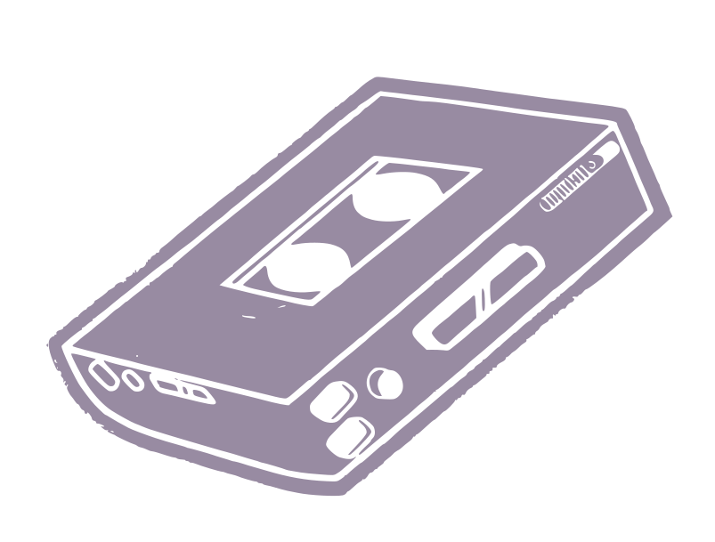

<br />
<div align="center">

<h1 align="center">Tapes V2</h1>



An atomic dotfile switcher for Linux and ricing.
Swap your whole setup in one command and get it back in one command.

Rewritten to be safer, simpler and truly atomic

<a href="https://github.com/futurekismo-oss/tapes-v2/issues/new">Report Bug</a>
&middot;
<a href="https://github.com/futurekismo-oss/tapes-v2/issues/new">Request Feature</a>

</div>

[](LICENSE)
[](Cargo.toml)
[](https://github.com/futurekismo-oss/tapes-v2/releases)

---

## Why Use Tapes?

If you're like me and a big unixporn fan, you've definitely found yourself wanting to try new rices however the worry of trashing your old config holds you back. install scripts barely care, they frequentely override previous configs or just backup the entire config folder and make a new one forcing you go to back and manually move files to fix the mess. 

Tapes aims to solve this by making trying out new rices and switching between them as frictionless as while being safe and fast. Other dotfile managers have come close but dont give this feeling of pop in a config and pop it out as fast. ( this is where the name came from ). The initial implementation (v1) was hasty and buggy. It was a prototype.

Now let's explain the terms you'll come across while using this program

**Tape**: A tape is ~/.config folder, a rice, a dotfile whatever you call it. it contains folders like `quickshell` and `hypr` the like, tapes can take this config folder, swap its `targets` or folders with your own, allowing you to use the quickshell and hypr config in this tape easily without losing things like `chromium` keys (which are stored in `~/.config/chromium` for some reason) 

**Target**: A target is a folder in a tape, a `quickshell` folder, `hypr` folder but a target can also be a file e.g `.zshrc`, `starship.toml`, these targets tell tapes the config you wanna insert into your `~/.config` folder 

**Atomic**: you've heard me say it alot, it means there is no inbetween, when tapes insert a tapes, it takes the files from your `~/.config` folder asks the tape the config its provides, then builds an entire config called `~/.config.tapes` made up of symlinks from the tape and your previous config, it then uses the renameat linux syscall to swap your `~/.config` with `~/.config.tapes`. Your old `~/.config` becomes `~/.config.tapes` and vice versa. Because there is no inbetween state where tapes is missing, it can call itself atomic, as anyone before the swap can be easily rolled back by deleting `~/.config.tapes`

**Hooks**: Shell commands in the tape.toml, tapes can run them after insert, after eject or after install, *Make sure to read these if a repo provides its own tape.toml, it shouldn't*

---

## Tapes in Action

https://github.com/user-attachments/assets/6791a91b-a3be-429b-9fd0-adc34fc93b08

---

## Quickstart

either package a `~/.config` as a tape (put in it a folder, move to `~/.tapes` and add a tape.toml inside) or install one directly from a repo. Then you can easily insert to try it out and eject as easily to return back to your old `~/.config`

```bash
# You found a cyberpunk dotfiles in a public repo
tapes-v2 install https://github.com/some_user/cyberpunk --name cyberpunk 
# if its in a specific branch or subdir in the repo, utilize the --branch and --dir subcommands

# Insert a tape sitting in ~/.tapes
tapes-v2 insert cyberpunk # tapes expects the tape in ~/.tapes/cyberpunk

# Wanna see its properties and hooks before insertion?
tapes-v2 show cyberpunk

# List all the tapes in ~/tapes
tapes-v2 show

# Is a tape currently inserted?
tapes-v2 status

# Wanna go back to your old config?
tapes-v2 eject
```

Simple as that
A tape.toml is expected to look like this

```toml
[tape]
name = "cyberpunk" # required
desc = "A cool cyberpunk rice"
dependencies = ["hyprland", "quickshell"] # just useful data for the user, tapes does nothing with it as of now

[hooks]
insert = [
  "hyprctl reload",
  "qs kill",
  "waybar &",   "notify-send 'Tapes' 'Switched to cyberpunk rice'"
]

eject = [
  "hyprctl reload",
  "pkll waybar",
  # Tapes runs commands in the current shell session, so try to move them to the background
  "qs -c caelestia -d",  
  "notify-send 'Tapes' 'Back to caelestia'",
]

# install = [] # exists btw
```

Tapes expects directory tree to look like this

```text
cyberpunk/
├── tape.toml         
├── hypr/             
│   └── hyprland.conf
├── waybar/           
│   └── config.jsonc
└── nvim/            
    └── init.lua
```


Some handy flags for tapes

```bash
--dry-run # shows the plan without touching any files
--no-hooks # skip running any hooks
--path # insert a tape straight out any folder
-q # quiet output
-v # verbose output
--logging # show logs, useful for reporting issues and debugging
```

---

## Acknowledgements

Thanks to these wonderful individuals for

[erotic-erox](https://github.com/exotic-erox) for calling out some lifecycle bugs on version 0.1.2-beta

[LilaccFlowerr](https://github.com/LilaccFlowerr) for providing the tapes-v2 showcase video and hopefully a gui in the future

[saksham_kumar](https://github.com/saksham_kumar) for being a contributor and writing the beloved install command

[Mvk](https://github.com/Mvkweb) for providing words of encourgement and support

[Clover](https://github.com/Cloverthestars) for providing the most encourgement and support, without them tapes wouldn't have gotten a rewrite and would have been the broken mess it was in Cassette-tapes, so massive thanks to him

---

## Roadmap

- [ ] A TUI or GUI
- [ ] Colored output
- [ ] More features

---

## Contributing

Contributions are welcome. See [Contributing.md](Contributing.md) for the guidelines.

The internals of how Tapes works live in [INTERNALS.md](INTERNALS.md) — worth a read before you touch the code.

---

## License

Distributed under the [MIT License](LICENSE).


